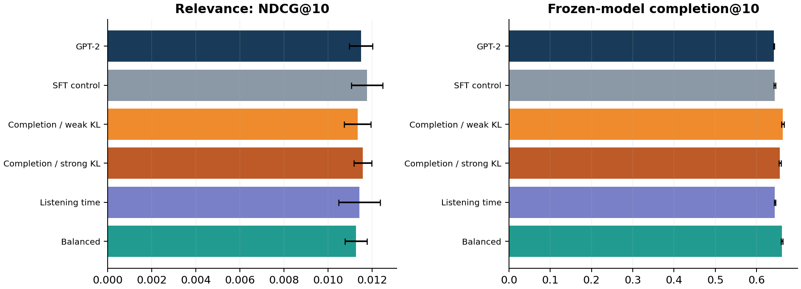
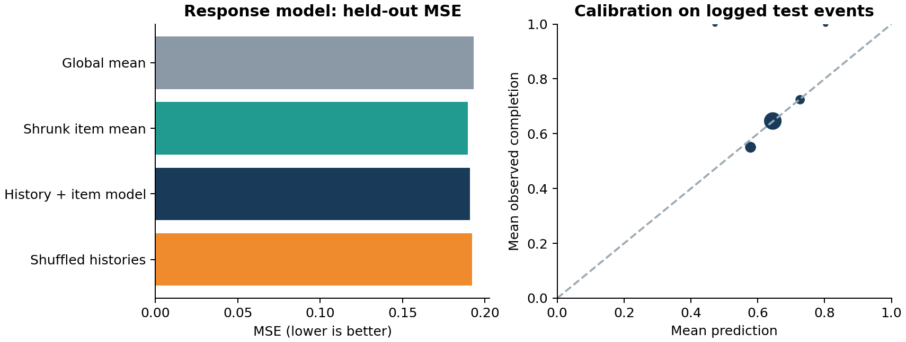
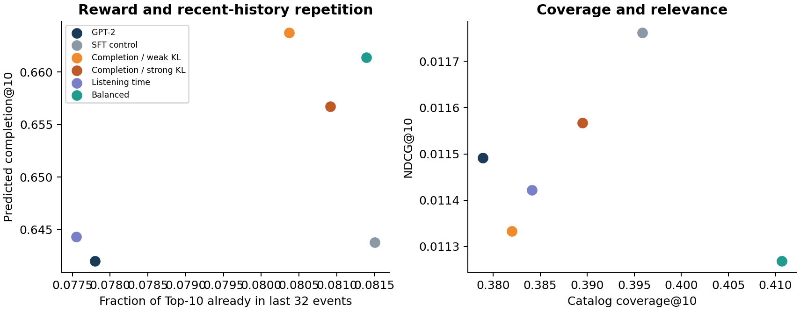
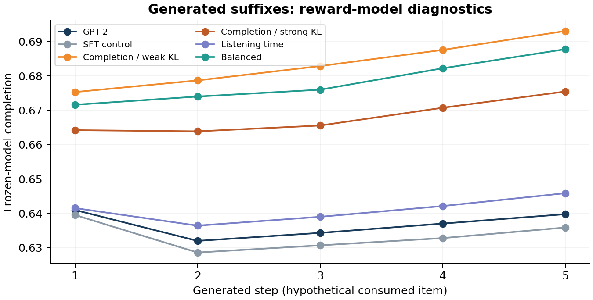

# RL-дообучение GPT-2 для музыкальных рекомендаций

Даниил Унковский · Т-Образование · 25 октября 2026

**Статус: эксперимент выполнен.** В репозитории есть код, подготовленные данные, веса,
сырые метрики, журналы обучения, графики и PDF. Это исследовательский прототип на
ограниченном каталоге, не промышленный рекомендатель и не полное воспроизведение статей.

## Основной результат

На Yambda-50M обучена компактная GPT-2 (233,344 параметра), отдельная модель доли прослушивания и четыре RL-варианта. Проведены три запуска (17, 29, 43), добавлен контроль продолжения обычного обучения. Награда за долю со слабым KL изменила предсказанную долю в Top-10 на +0.0217. Это изменение суррогата, а не измерение реальной пользы. Лучший средний NDCG@10 среди нейросетевых вариантов: SFT-контроль (0.01176); недавние треки дают 0.02178. Нейросетевая модель отклика уступает среднему по треку. Эти ограничения не позволяют объявить RL улучшением пользовательского опыта.



## 1. Постановка и гипотезы

По прошлой истории прослушиваний предсказывается следующий трек. После supervised
обучения GPT-2 политика дообучается на предсказанном отклике. Проверяются три гипотезы:
(1) награда меняет распределение рекомендаций; (2) рост суррогатной награды не обязан
повышать релевантность; (3) регуляризация и выбор reward меняют компромисс.

Токены - идентификаторы треков; текстовый токенизатор и предобученные текстовые веса
не используются. `GPT2LMHeadModel` из Transformers создаётся со случайными весами.

## 2. Данные, аудит и отсутствие утечек

Источник: Yandex Yambda-50M, `sequential/50m/listens.parquet`, 426,248,769 байт.
SHA-256: `c07db8326739b23fd4fb0a25037304e78b2e916320ccf1b01dc904d2b1b376c7`. Ревизия репозитория: `dd6f3a19eef5866e346c3270e098baa641a44948`.
Лицензия исходных данных: Apache-2.0; условия и изменения перечислены в DATA_LICENSE.md.

Фактически прочитаны **9,238 пользователей и 46,467,212 прослушиваний**.
В конкретном файле 9238 строк; общие 10000 пользователей из карточки относятся к
версии датасета в целом и не подменяют измеренный размер файла listens.
Использованы `uid`, `timestamp`, `item_id`, `played_ratio_pct`, `track_length_seconds`, `is_organic`.

Глобальные временные границы заданы по 80/10/10% длительности наблюдений:

| Период | Условие timestamp | Все события | События каталога | Покрытие |
| --- | --- | --- | --- | --- |
| Train | t < 20800000 | 34,286,453 | 9,004,944 | 26.26% |
| Validation | 20800000 ≤ t < 23400000 | 5,863,371 | 1,422,517 | 24.26% |
| Test | 23400000 ≤ t ≤ 26000000 | 6,317,388 | 1,344,276 | 21.28% |

Каталог - top-2048 треков только по частотам train. PAD=0, OOV=1, треки=2..2049.
Ни частоты, ни длительности, ни параметры моделей не обучаются на validation/test.
Подготовлено 304,894 обучающих контекстов и по 6000 отложенных запросов;
в validation известны 1561 целей, в test - 1346.
Внешние цели сохраняются как OOV и считаются промахами в основных retrieval-метриках.

Контекст содержит последние 32 **строго более ранних** события. Все события с тем же
timestamp, что и цель, исключаются. OOV-события сохраняются в истории: удаление могло
бы создать ложную смежность треков. Аудит обнаружил 8,840,469
соседних совпадений timestamp, 218,145 долей выше 100%, 0
неупорядоченных пользователей и 0 нулевых длительностей.

Доля прослушивания: `y = min(played_ratio_pct / 100, 1)`. Значения выше 100% допустимы
в источнике и здесь ограничиваются как осознанное определение цели, а не очистка шума.

## 3. Модели и обучение

**GPT-2:** 2 слоя, 4 головы, embedding=64, контекст=32, dropout=0.1,
233,344 параметра. На последнем наблюдаемом состоянии
вычисляется full-catalog cross entropy по следующему треку. Выходные PAD/OOV исключены.
AdamW, lr=0.001, batch=128, 1800 обновлений, warmup=100, cosine decay до 10% lr,
weight decay=0.01, clip norm=1. Checkpoint выбирается по validation NDCG@10 каждые 300
шагов. Выбранные шаги для seeds 17/29/43: [1800, 1800, 1800]. Оценка test не используется для выбора.

**Модель отклика:** независимые embedding=32; среднее истории, последний трек,
кандидат и произведение среднего с кандидатом подаются в MLP 128→64→32→1, sigmoid.
MSE по наблюдаемой доле прослушивания. AdamW lr=0.001, batch=256, 1400 обновлений;
выбор по validation MSE каждые 200 шагов. Затем веса заморожены во всех RL-запусках.
История и кандидат являются входом; `uid`, время и фактическая будущая доля не подаются.

### Качество модели отклика на известных целях

| Модель | Val MSE | Test MSE | Test MAE | AUC доля ≥0.9 |
| --- | --- | --- | --- | --- |
| Среднее | 0.18786 | 0.19321 | 0.41665 | 0.500 |
| Среднее по треку | 0.18526 | 0.18965 | 0.40827 | 0.571 |
| История + трек | 0.18710 | 0.19082 | 0.41182 | 0.559 |
| Перемешанные истории | 0.18822 | 0.19232 | 0.41404 | 0.540 |

Сглаженный средний отклик по треку: `(sum_y + 20 * global_mean) / (count + 20)`.
Эти простые ориентиры используют все известные train-события; нейросеть - выбранные
контексты. Neural Spearman на test: 0.0800.
Перемешивание историй сохраняет кандидатов и цели, но разрушает соответствие истории:
это проверка зависимости модели от контекста, а не самостоятельная оценка причинности.



## 4. RL: contextual-bandit REINFORCE

Состояние `s` - реальный прошлый контекст train; действие `a` - сэмплированный трек;
награждает замороженная модель `r_hat(s,a)`. Нет пропенсити логирования, поэтому не
заявляется корректная off-policy оценка. RL выполняет on-policy sampling внутри
**обученного суррогатного окружения**, а не внутри реального сервиса.

На контекст независимо с возвращением сэмплируются четыре действия. Для действия j
baseline равен среднему reward остальных трёх действий, `A_j = r_j - mean(r_other)`.
Baseline независим от собственного действия при данном контексте.

`L = -mean(A * log π(a|s)) + β KL(π || π_base) + 0.1 CE(π, logged_next_item)`.

KL рассчитывается точно по всем 2048 действиям. Reward и advantage отсоединены от
графа градиентов. Dropout в RL выключен, чтобы распределение сэмплирования совпадало
с дифференцируемым. AdamW lr=0.00008, 400 шагов, batch=128, clip=1, без weight decay.
Последний checkpoint фиксированного шага сохраняется без подбора по test.
Каждый вариант начинается с одинаковой базы соответствующего seed и получает один
и тот же поток train-контекстов и начальный RNG для сэмплирования.

| Вариант | Reward | β KL | REINFORCE |
| --- | --- | --- | --- |
| SFT-контроль | нет reward-градиента; только KL + 0.1 CE | 0.1 | выключен |
| Доля / слабый KL | r_hat | 0.02 | включён |
| Доля / сильный KL | r_hat | 0.2 | включён |
| Время | r_hat * min(train_mean_duration,600) / 600 | 0.1 | включён |
| Баланс | r_hat + 0.15 novelty - 0.25 recent_repeat | 0.1 | включён |

`novelty` - нормированная отрицательная log-частота по train, а не семантическое
разнообразие. `recent_repeat`=1, если действие есть в последних 32 событиях.
SFT-контроль получает то же число дополнительных шагов и ту же CE/KL часть, но
нулевой коэффициент REINFORCE. Он необходим для отделения эффекта RL от extra training.
Его beta=0.1 совпадает с вариантами Время и Баланс. Для completion beta=0.02/0.2,
поэтому разница с SFT-контролем включает также изменение силы KL и не является
чистой абляцией одного reward-градиента.

## 5. Протокол и основные результаты

Три policy seed: 17, 29, 43; модель отклика общая (seed=17). Все варианты ранжируют
весь одинаковый каталог из 2048 треков, без sampled negatives. Повторы не маскируются,
так как музыка допускает повторное потребление. Один отложенный next item на запрос:
Recall@K=HitRate@K; NDCG даёт вес `1/log2(rank+1)` при попадании. Также сохранены K=5/20.

Ниже среднее ± выборочное стандартное отклонение по трём policy seed. Основные
метрики считаются по всем 6000 запросам, включая OOV-промахи. `Catalog NDCG` условен
на 1346 целях в каталоге и не заменяет основной результат.

| Модель | Recall@10 | NDCG@10 | Catalog NDCG@10 |
| --- | --- | --- | --- |
| Популярность | 0.01067 ± 0.00000 | 0.00421 ± 0.00000 | 0.01875 |
| Недавние треки | 0.03600 ± 0.00000 | 0.02178 ± 0.00000 | 0.09710 |
| GPT-2 | 0.02200 ± 0.00126 | 0.01149 ± 0.00053 | 0.05123 |
| SFT-контроль | 0.02239 ± 0.00170 | 0.01176 ± 0.00071 | 0.05243 |
| Доля / слабый KL | 0.02250 ± 0.00161 | 0.01133 ± 0.00060 | 0.05052 |
| Доля / сильный KL | 0.02244 ± 0.00106 | 0.01157 ± 0.00040 | 0.05156 |
| Время | 0.02217 ± 0.00219 | 0.01142 ± 0.00094 | 0.05092 |
| Баланс | 0.02217 ± 0.00126 | 0.01127 ± 0.00050 | 0.05023 |

| Модель | Pred. completion@10 | Повтор истории@10 | Покрытие каталога@10 |
| --- | --- | --- | --- |
| Популярность | 0.6124 ± 0.0000 | 0.028 | 0.005 |
| Недавние треки | 0.6292 ± 0.0000 | 0.534 | 0.995 |
| GPT-2 | 0.6420 ± 0.0008 | 0.078 | 0.379 |
| SFT-контроль | 0.6438 ± 0.0023 | 0.082 | 0.396 |
| Доля / слабый KL | 0.6637 ± 0.0029 | 0.080 | 0.382 |
| Доля / сильный KL | 0.6567 ± 0.0023 | 0.081 | 0.389 |
| Время | 0.6444 ± 0.0017 | 0.078 | 0.384 |
| Баланс | 0.6614 ± 0.0025 | 0.081 | 0.411 |

Predicted completion@10 - среднее предсказание замороженной модели по Top-10,
а не наблюдаемое качество рекомендаций. Повтор истории - доля Top-10 из последних
32 событий; покрытие - доля каталога, появившаяся хотя бы в одном Top-10.

### Парные различия и неопределённость

На каждом тестовом пользователе метрика усредняется по трём seed. Затем 2000 раз
с возвращением сэмплируются пользователи, вычисляется парная разница. Показаны
95% percentile-интервалы. Это условная неопределённость по пользователям, не полная
неопределённость обучения; один reward model и каталог остаются фиксированными.

Разница с исходной GPT-2:

| Вариант | Δ NDCG@10 [95% CI] | Δ Pred. completion@10 [95% CI] |
| --- | --- | --- |
| SFT-контроль | +0.00027 [-0.00008; +0.00060] | +0.00174 [+0.00160; +0.00189] |
| Доля / слабый KL | -0.00016 [-0.00079; +0.00045] | +0.02170 [+0.02138; +0.02203] |
| Доля / сильный KL | +0.00008 [-0.00039; +0.00054] | +0.01466 [+0.01442; +0.01491] |
| Время | -0.00007 [-0.00074; +0.00064] | +0.00231 [+0.00216; +0.00245] |
| Баланс | -0.00022 [-0.00085; +0.00037] | +0.01933 [+0.01903; +0.01962] |

Разница с SFT-контролем (проверка добавочной пользы reward-градиента):

| RL-вариант | Δ NDCG@10 [95% CI] | Δ Pred. completion@10 [95% CI] |
| --- | --- | --- |
| Доля / слабый KL | -0.00043 [-0.00102; +0.00015] | +0.01996 [+0.01969; +0.02025] |
| Доля / сильный KL | -0.00020 [-0.00062; +0.00025] | +0.01292 [+0.01273; +0.01312] |
| Время | -0.00034 [-0.00099; +0.00033] | +0.00057 [+0.00043; +0.00071] |
| Баланс | -0.00049 [-0.00109; +0.00010] | +0.01758 [+0.01734; +0.01784] |

## 6. Поведение, повторы и гипотетические продолжения

| Модель | Sampled reward | Sampled recent repeat | Доля самого частого Top-1 | Длительность Top-10, c |
| --- | --- | --- | --- | --- |
| GPT-2 | 0.6422 | 0.022 | 0.132 | 185.1 |
| SFT-контроль | 0.6423 | 0.023 | 0.134 | 184.9 |
| Доля / слабый KL | 0.6460 | 0.022 | 0.136 | 181.1 |
| Доля / сильный KL | 0.6447 | 0.023 | 0.134 | 182.9 |
| Время | 0.6426 | 0.022 | 0.138 | 218.3 |
| Баланс | 0.6453 | 0.020 | 0.137 | 182.7 |

Sampled reward и repeat усреднены по 16 действиям на тестовый контекст с фиксированным
RNG. Это ближе к обучаемому стохастическому распределению, чем жёсткий Top-10.
При отсутствии предсказанного ответа реальные будущие истории не изменяются.



Для первых 512 тестовых контекстов генерируется пять жадных рекомендаций. Каждая
рекомендация добавляется в историю как **гипотетически потреблённая**, реальный отклик
не подменяется наблюдением. Рассчитан `sum(gamma^t * r_hat_t)`, gamma=0.9.
Результаты - модельная диагностика, не доказательство session return или удержания.

| Модель | Model return | Повторы внутри 5 | Из исходной истории | Различных треков |
| --- | --- | --- | --- | --- |
| GPT-2 | 2.608 | 0.760 | 0.143 | 123.7 |
| SFT-контроль | 2.595 | 0.763 | 0.155 | 127.7 |
| Доля / слабый KL | 2.795 | 0.784 | 0.143 | 126.7 |
| Доля / сильный KL | 2.733 | 0.771 | 0.146 | 129.7 |
| Время | 2.624 | 0.781 | 0.134 | 117.7 |
| Баланс | 2.774 | 0.776 | 0.151 | 138.3 |



В `results/seed_*/..._evaluation.json` сохранены примеры raw item ID и предсказаний,
в том числе оценка с исходным контекстом без сгенерированного суффикса. Названий,
жанров и аудиопризнаков в этом эксперименте нет; семантические объяснения треков не выдумываются.

## 7. Выводы

1. GPT-2 превосходит популярностный ориентир по NDCG@10 (0.01149 против 0.00421), но уступает недавним трекам (0.02178). Это сильная и необходимая проверка в музыке с повторными прослушиваниями.
2. Рост предсказанной награды и рост точности - разные результаты. Изменения NDCG оцениваются вместе с парными интервалами, а не только по знаку среднего.
3. SFT-контроль проверяет вклад продолжения обучения на прежних next-item целях. Для вариантов Время и Баланс совпадает также beta=0.1; у двух completion-вариантов beta отличается, поэтому их сравнение с этим контролем не изолирует только reward-градиент.
4. Модель отклика использует историю: перемешивание историй ухудшает MSE. При этом простой сглаженный приор по треку лучше по тестовому MSE; нейросетевой симулятор слишком слаб для выводов о долгосрочной пользе.
5. Изменение функции награды меняет состав рекомендаций. Штраф за повтор применяется к сэмплированному действию и не обязан уменьшать долю повторов в детерминированном Top-10.
6. Каталог ограничен 2048 популярными обучающими треками и покрывает 21.3% всех тестовых событий. Основные метрики учитывают OOV как промахи; условные метрики по каталогу показаны отдельно.
7. Пятишаговое продолжение - диагностика гипотетических рекомендаций при предположении их потребления, а не восстановленная реакция реального пользователя. Удержание и накопленная реальная полезность не оценены.

## 8. Ограничения и дальнейшие проверки

- Ограниченный каталог и короткий контекст: 2048 из 739583 обучающих треков, 32 последних события. OOV остаётся в истории отдельным токеном, поэтому нельзя интерпретировать результаты как полноразмерную систему.

- Разбиение глобальное по времени, а не leave-one-out по каждому пользователю. Пользователи могут встречаться в разных периодах. В тестовом контексте разрешены уже произошедшие validation/test взаимодействия: это rolling-history оценка без обновления весов.

- Сэмплирование: до 40 известных обучающих целей на пользователя; по одной случайной цели на пользователя в каждом отложенном периоде. Пользователи имеют равный вес в оценке. Это не все события и не протокол официального бенчмарка Yambda.

- Неопределённый порядок событий с одинаковым временем устранён исключением всех таких событий из контекста цели. Источник содержит 8840469 соседних совпадений времени. Внутренние единицы времени не переводятся в календарные даты.

- Доля больше 100% в исходных данных отражает повторное прослушивание. Она намеренно ограничена единицей в целевой функции; информация о повторном времени при этом теряется. Временная награда использует среднюю обучающую длительность трека, ограниченную 600 секундами.

- Отклик доступен только для фактически прослушанных треков. Пропенсити логирующей политики нет; IPS/DR и причинная оценка не выполнялись. Ненаблюдаемые рекомендации не объявляются отрицательными примерами.

- RL здесь - одноступенчатый contextual bandit на фиксированных реальных контекстах с замороженной reward model. Многошаговый RL, PPO и поправка off-policy из статьи 2607.02818 не реализованы и не заявляются.

- Три seed относятся к политике; модель отклика одна. Bootstrap по пользователям условен на этой модели, датасете и каталоге. Он не покрывает все источники неопределённости и не корректирует множественные сравнения.

- Число шагов и коэффициенты зафиксированы в конфигурации. После тестового сравнения гиперпараметры не подбирались. Размеры модели ограничены CPU, качество базы не доведено до уровня сильных полноразмерных рекомендателей.

Следующие эксперименты: увеличить каталог/контекст и качество next-item базы;
сравнить reward model с temporal cross-fitting и более сильными приорами; добавить
ансамбль/неопределённость reward, консервативное ограничение политики, несколько
инициализаций reward model. Долгосрочные прокси (следующее взаимодействие, длина
сессии, возврат после перерыва) требуют отдельного определения сессий и проверки
смешения временных факторов. Причинные выводы потребуют корректного OPE при
известных propensity или онлайн-эксперимента; по этим данным они не получены.

## 9. Связь с материалами задания

Работа 2403.04875 мотивирует поэлементную генерацию и оптимизацию целей сверх
точности; здесь реализован компактный next-item GPT-2 с двумя стадиями обучения,
но teacher-student стадия и семантическая diversity из статьи не воспроизводятся.
Работа 2607.02818 рассматривает session-level обучение и feedback model на Yambda;
здесь взята идея отдельной модели отклика, но используется GPT-2 вместо two-tower,
один шаг REINFORCE вместо multi-step off-policy correction и нет DR/OPE.
Это самостоятельный небольшой эксперимент по постановке задания, а не репликация
результатов перечисленных статей.

## 10. Воспроизведение и запуск

Проверенная среда: Python 3.12.14, PyTorch 2.14.1+cpu, CPU, 4 потока,
Transformers 5.20.2. GPU не требовался. На этом CPU
суммарное время обучения (reward + 3 базы + 15 продолжений) составило
785.1 сек.; сюда не включены скачивание, подготовка, тесты и построение отчёта.
Рекомендуется 4+ ГБ RAM для запуска готовых весов и 8+ ГБ для воспроизведения.
Python 3.12 выбран для воспроизводимости; старая учебная .venv с Python 3.14 не нужна.

Из корня клонированного или распакованного проекта:

```powershell
python -m venv .venv
# PowerShell / Windows:
.\.venv\Scripts\Activate.ps1
# Linux/macOS instead: source .venv/bin/activate
python -m pip install --upgrade pip
python -m pip install torch==2.14.1 --index-url https://download.pytorch.org/whl/cpu
python -m pip install -r requirements.txt
python -m pytest -q
python -m recsys.verify --require-results
python -m recsys.recommend --demo 0 --k 10
```

Если PowerShell запрещает Activate.ps1, активация не обязательна: каждую команду
`python ...` можно запустить как `& .\.venv\Scripts\python.exe ...`.

```bash
# Reproduce all training runs from the included prepared data:
python run_all.py

# Regenerate the prepared data from the pinned 426 MB source:
python -m recsys.data --download

# Individual stages:
python -m recsys.experiment
python -m recsys.analysis
python -m recsys.report
```

`run_all.py` заново обучает и заменяет результаты в results; для сохранения исходного результата можно использовать отдельную копию репозитория. Для одного seed: `python -m recsys.experiment --seeds 17 --out results_one_seed`.
Для GPU при наличии подходящей сборки PyTorch: `python -m recsys.experiment --device cuda`;
этот вариант не проверялся, CPU-метрики могут не совпасть бит-в-бит.
Команды `analysis/report/recommend` по умолчанию читают основной каталог results.

Структура:

- `recsys/data.py`: скачивание с SHA-256, аудит, временное разбиение, подготовка.
- `recsys/models.py`: GPT-2 и отдельная reward model.
- `recsys/experiment.py`: обучение, REINFORCE, SFT-контроль, оценка.
- `recsys/evaluate.py`: full-catalog метрики и гипотетические rollout.
- `recsys/analysis.py`: агрегирование seed, bootstrap, графики, CSV.
- `recsys/recommend.py`: просмотр рекомендаций готового checkpoint.
- `recsys/verify.py`, `tests/`: проверки протокола, causal mask и градиента REINFORCE.
- `configs/main.json`: все размеры, seed и гиперпараметры.
- `data/processed/`: подготовленные примеры и отображение токенов.
- `results/`: веса `.pt`, сырые метрики, per-query `.npz`, логи, графики, environment.
- `report.pdf`: самостоятельный читаемый отчёт.

Большой исходный Parquet в репозиторий не включён. Подготовленные данные и веса позволяют
проверить результаты без повторного скачивания. Для полного воспроизведения подготовки
используется закреплённый источник и SHA-256. На CPU при фиксированном стеке ожидается
повторяемость; файлы NPZ могут иметь иные байтовые хеши из-за метаданных ZIP, поэтому
для сравнения повторно подготовленных данных проверяются массивы и аудит.

## Источники

- [Yandex Yambda: dataset card, schema, license, timestamp ordering and replay interpretation](https://huggingface.co/datasets/yandex/yambda/blob/main/README.md)
- [Petrov, Macdonald. Aligning GPTRec with Beyond-Accuracy Goals with Reinforcement Learning (2024)](https://arxiv.org/abs/2403.04875)
- [Matveev et al. Session-Level Optimization for Large-Scale Retrieval using REINFORCE with Multi-Step Off-Policy Correction (2026)](https://arxiv.org/abs/2607.02818)
- [Hugging Face Transformers: GPT-2 model documentation](https://huggingface.co/docs/transformers/model_doc/gpt2)
